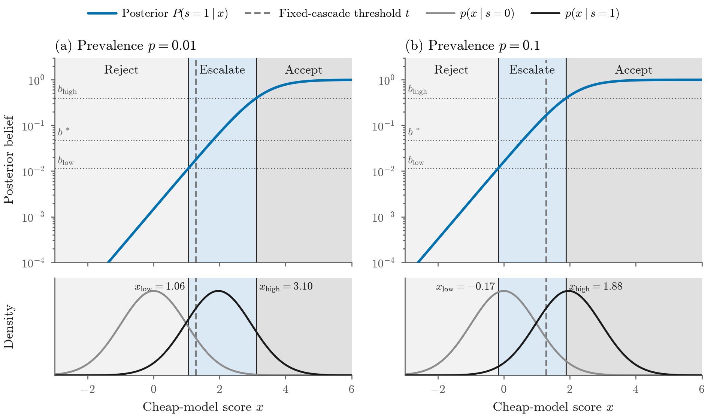
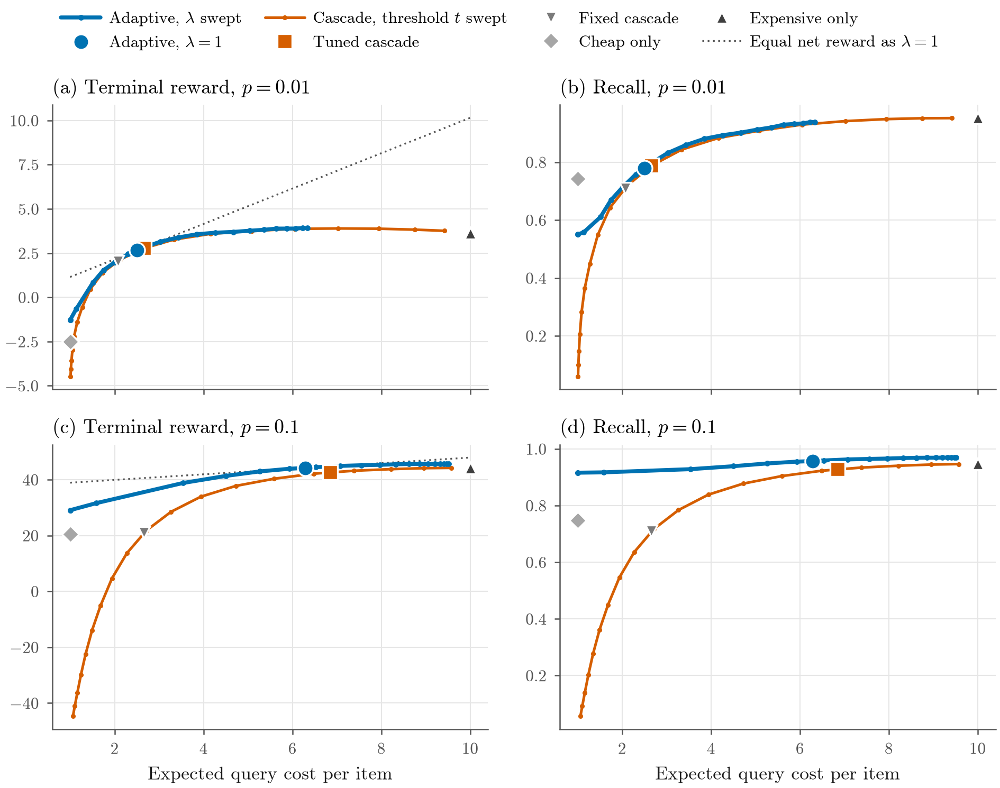

<div align="center">

# Budgeted Model Escalation for Rare-Target Search

</div>

_A cheap detector flags a possible target in a satellite tile. Should the system trust it, dismiss it, or pay ten times as much to ask a better model?_

This project treats that question as a small POMDP. The agent sees a cheap model's confidence score, updates its belief about whether a target is present, and then accepts, rejects, or escalates to an expensive model. It escalates only when the value of information from the expensive model exceeds its cost. This model-based policy **matches a well-tuned cascade without any threshold tuning**. It **strictly improves on the cascade** when confident cheap-model scores can be accepted without escalation: up to +2.09 ± 0.24 net reward per item at 10% prevalence. Its advantage depends on an accurate observation model.



*The adaptive policy in score space. Top: the posterior after the cheap score x, with the belief thresholds derived from the reward model. Bottom: class-conditional score densities. Scores below x<sub>low</sub> are rejected, scores above x<sub>high</sub> are accepted, and only the uncertain band in between is sent to the expensive model. At higher prevalence (right) the whole band shifts left. The dashed line is a fixed cascade's single cutoff.*

---

## What's here

A synthetic rare-target environment with two noisy classifiers, a Bayesian agent that reasons about whether to escalate, and four baselines. Everything is simulated (no datasets, APIs, or trained models), so every quantity is known and every comparison is exact.

| Policy | Behavior |
|---|---|
| **Adaptive (VOI)** | Query cheap; reject if $b \le b_{\text{low}}$, accept if $b \ge b_{\text{high}}$, otherwise escalate and accept iff $b \ge b^*$. Thresholds are derived, not tuned. |
| **Tuned cascade** | Query cheap; escalate if $x \ge t$, else reject; final label from the expensive model. $t$ is tuned for reward on a separate seed (model-free, needs labeled data). |
| Fixed cascade | Same, with a fixed operating point $t = 1.28$ |
| Cheap only | Accept iff $x \ge t$ |
| Expensive only | Accept iff the expensive model says positive |

Beyond the default comparison, the project includes:
- three parameter sweeps: prevalence, expensive-model cost, and cheap-model quality;
- a **budget frontier** that sweeps a Lagrange multiplier on query cost;
- a **robustness study** in which the agent plans with wrong parameters.

_The problem follows the belief-state POMDP formulation of Kochenderfer, Wheeler & Wray, [Algorithms for Decision Making](https://algorithmsbook.com) (MIT Press, 2022). It is motivated by rare-target search in satellite imagery, where a cheap screening model and an expensive high-accuracy model are both available._

## Model

Each item is a short POMDP that ends when the agent accepts or rejects.

| | |
|---|---|
| State | $s \in \{0,1\}$, hidden; $P(s=1) = p$ (small) |
| Actions | `query_cheap`, `query_expensive`, `accept_target`, `reject_target` |
| Cheap observation | score $x$ with $x \mid s{=}0 \sim \mathcal N(0,1)$ and $x \mid s{=}1 \sim \mathcal N(d',1)$ |
| Expensive observation | $o \in \{+,-\}$ with $P(o{=}+ \mid s{=}1) = \text{TPR}$ and $P(o{=}+ \mid s{=}0) = \text{FPR}$ |
| Belief | $b = P(s=1 \mid \text{history})$, starting at $b_0 = p$ |
| Reward | $R_{TP}$ for a true positive, $-C_{FP}$ / $-C_{FN}$ for errors, $0$ for a true negative, minus each query's cost $c_m$ |

The cheap model's quality is one number, the class separation $d'$ (ROC AUC $= \Phi(d'/\sqrt2)$). Think of $x$ as a logit.

**Belief update.** Bayes' rule is exact, and for the Gaussian score it is linear in log-odds:

$$\text{logit}(b') = \text{logit}(b) + d'x - \tfrac{1}{2}d'^2,$$

so every belief threshold maps to a score threshold.

**Terminal decision.** Accept iff $b \ge b^* = C_{FP} / (R_{TP} + C_{FN} + C_{FP})$.

**Escalation.** From belief $b$, query the expensive model iff

$$\sum_{o} P(o \mid b)\,\max_{d}\,\mathbb{E}[r_d \mid b'_o] \;-\; c_{\text{exp}} \;>\; \max_d \mathbb{E}[r_d \mid b].$$

The beliefs satisfying this form an interval $[b_{\text{low}}, b_{\text{high}}]$ containing $b^*$. Only one query can follow the cheap one, so this one-step lookahead is **Bayes-optimal among cheap-first policies**.

A cascade has one cutoff (reject or escalate). The adaptive policy has two, so it can also *accept* confident scores without paying for escalation. That is where it can beat even a tuned cascade.

**Budget interpretation.** Maximizing $\mathbb{E}[\text{terminal reward}]$ subject to $\mathbb{E}[\text{query cost}] \le B$ has the Lagrangian $\mathbb{E}[\text{terminal reward}] - \lambda\,\mathbb{E}[\text{cost}]$. Planning as if the expensive query cost $\lambda c_{\text{exp}}$ (`PosteriorThreshold.from_params(params, cost_scale=λ)`) gives the policy for each budget. $\lambda = 1$ is the net-reward policy.

**Assumptions.** Observations are conditionally independent given $s$. Each model is queried at most once per item. The cheap model is always queried first.

**Defaults** (all in `models.py`):
- $p = 0.01$
- cheap model: $d' = 1.96$, cost 1; at $t = 1.28$ its TPR is 0.75 and FPR 0.10
- expensive model: TPR 0.95, FPR 0.02, cost 10
- rewards: $R_{TP} = 500$, $C_{FP} = 50$, $C_{FN} = 500$

## Key results

All differences are paired per item on common random numbers (200k items), with 95% confidence intervals. The reference is a cascade whose threshold was tuned on a separate seed.

* **Without tuning, the adaptive policy matches a tuned cascade.** At the default setting the difference is +0.04 ± 0.06 net reward per item, a statistical tie. The adaptive policy escalates 15% of items for 2.51 cost per item; the tuned cascade escalates 17% for 2.66. The fixed cascade is −0.14 ± 0.12.

* **The adaptive frontier is never beaten.** Sweeping λ traces the adaptive policy's cost–reward frontier, and sweeping $t$ traces the cascade's. No cascade threshold reaches higher terminal reward at equal cost, at either $p = 0.01$ or $p = 0.1$.

* **It strictly wins where the accept region matters.** Out of 20 comparisons against the tuned cascade across all sweeps, there are 8 significant wins, 12 ties, and **0 losses**. The clearest wins:

  | Setting | Net-reward gain vs. tuned cascade |
  |---|---|
  | 10% prevalence | +2.09 ± 0.24 |
  | 5% prevalence | +0.67 ± 0.15 |
  | Strong cheap model ($d' = 4$) | +0.40 ± 0.09 |
  | Expensive model too costly to use ($c_{\text{exp}} = 100$) | +1.73 ± 0.21 |

* **Escalation adapts as theory predicts.**
  - The rarer the targets, the less it escalates, trading recall for cost.
  - The escalation band shrinks as the expensive model gets costlier, and disappears at $c_{\text{exp}} \ge 50$.
  - The better the cheap model, the fewer items it escalates: from 30% at $d' = 0.5$ to 2% at $d' = 4$.

* **Its advantage depends on an accurate model.**
  - At $p = 0.1$, the adaptive policy stays above the tuned cascade while the assumed prevalence is within 0.38×–2.82× of the truth, or the assumed $d'$ is within 0.56×–1.32×.
  - Overestimating the cheap model's quality costs far more than underestimating it: assuming $d'$ is 2× too high puts the policy 19.0 below the tuned cascade, while 0.5× puts it only 0.46 below.
  - At $p = 0.01$ there is no margin, so a tuned cascade is the safer choice.

* **Limitation: the cheap model is always queried first.** When the expensive model costs about as much as the cheap one ($c_{\text{exp}} = 1$), querying the expensive model alone is best (net reward 2.62 vs. 2.39 for the adaptive policy).



*Terminal reward and recall vs. expected query cost at p = 0.01 (top) and p = 0.1 (bottom). Blue: the adaptive policy as λ varies (large dot: λ = 1). Vermillion: the cascade as its threshold varies (square: tuned). Grey: fixed baselines. The dotted line has equal net reward to λ = 1.*

## Paper figures and tables

| Asset | File | Content |
|---|---|---|
| Fig 1 | `figures/policy_diagram.pdf` | Reject / escalate / accept regions in score space |
| Table 1 | `results/default_comparison.tex`* | Default setting, paired differences vs. tuned cascade |
| Fig 2 | `figures/frontier.pdf` | Terminal reward and recall vs. query cost, p = 0.01 and 0.1 |
| Fig 3 | `figures/sweeps_summary.pdf` | Reward vs. tuned cascade and escalation rate across the three sweeps |
| Table 2 | `results/sweeps_summary.tex`* | Numbers behind Fig 3 |
| Fig 4 | `figures/robustness.pdf` | Reward vs. tuned cascade under misspecified prevalence and $d'$ |
| Table 3 | `results/robustness_breakeven.tex`* | Tolerated misspecification ranges |

\* Generated by `make_paper_assets.py` but not committed. The same numbers are in the committed CSVs (`default_comparison.csv`, the three `sweep_*.csv` files, and `robustness_breakeven.csv`).

**Using them in LaTeX**
- Every figure is committed as a vector `.pdf` (fonts embedded as TrueType). Regenerating also writes 300-dpi `.png` previews. Only the two shown in this README are committed.
- Figures are drawn at a 6.5 in text width, so include them with `\includegraphics[width=\textwidth]{...}` to keep fonts at their designed size.
- Tables need `\usepackage{booktabs}`.
- In Tables 1–2, **bold** marks a difference whose 95% CI excludes zero in the adaptive policy's favor.
- In Table 3, † marks rows with no significant advantage at the true parameters; note this in the caption.

## Tech stack

- **Python 3.10+**
- [`numpy`](https://numpy.org) for simulation and Bayes updates
- [`pandas`](https://pandas.pydata.org) for per-item results and summaries
- [`matplotlib`](https://matplotlib.org) for figures (Computer Modern fonts; Okabe–Ito colorblind-safe palette)
- [`pytest`](https://pytest.org) for tests

Results in `results/` were generated with Python 3.13, numpy 2.5, pandas 3.0, and matplotlib 3.11. The code runs on CPU only, with no ML framework, and regenerating every figure and table takes about 2 minutes on a laptop.

## Repository layout

```
.
├── README.md                     project overview + reproduce instructions
├── pyproject.toml                package metadata and dependencies
├── LICENSE                       MIT
│
├── src/adaptive_model_routing/   library code
│   ├── models.py                 ScoreModel (cheap), SensorModel (expensive), RewardModel, ProblemParams
│   ├── belief.py                 Bayes update, terminal values, accept threshold, escalation band
│   ├── environment.py            item sampling and terminal reward
│   ├── policies.py               baselines and the adaptive policy (with cost scale λ)
│   ├── simulation.py             act → observe → update loop, Monte Carlo, cascade tuning, sweeps
│   └── metrics.py                recall, precision, FPR/FNR, cost, escalation rate, paired differences
│
├── experiments/                  one runnable script per experiment
│   ├── make_paper_assets.py      regenerates every figure and table below
│   ├── policy_diagram.py         Fig 1
│   ├── run_default.py            Table 1 (+ supplementary bar chart)
│   ├── frontier.py               Fig 2: λ and t sweeps
│   ├── sweep_prevalence.py       prevalence sweep
│   ├── sweep_expensive_cost.py   expensive-model cost sweep
│   ├── sweep_cheap_quality.py    cheap-model d′ sweep
│   ├── robustness.py             Fig 4, Table 3: misspecified prevalence and d′
│   ├── common.py                 CLI, shared plotting helpers, LaTeX tables
│   └── style.py                  figure theme: fonts, sizes, policy colors, PNG + PDF saving
│
├── tests/                        Bayes updates, policy logic, simulator, tuning, paired statistics
│
├── figures/                      generated figures (PDF; PNG only for the two README images)
└── results/                      generated CSVs (LaTeX tables are regenerated locally)
```

## Running it

Setup once:

```bash
python -m venv .venv
source .venv/bin/activate
pip install -e ".[dev]"
pytest
```

Regenerate every paper figure and table (about 2 minutes; `--quick` uses 20k items for a 15-second smoke test):

```bash
python experiments/make_paper_assets.py
```

Or run experiments individually. Each writes a CSV to `results/` and figures to `figures/`:

```bash
python experiments/policy_diagram.py        # Fig 1
python experiments/run_default.py           # Table 1; --help to override p, d', t, c_exp
python experiments/frontier.py              # Fig 2
python experiments/sweep_prevalence.py      # p in {0.001, ..., 0.1}
python experiments/sweep_expensive_cost.py  # c_exp in {1, ..., 100}
python experiments/sweep_cheap_quality.py   # d' in {0.5, ..., 4}
python experiments/robustness.py            # Fig 4, Table 3
```

**Reproducibility**
- Every script takes `--seed` (evaluation, default 0), `--tune-seed` (cascade tuning, default 1), and `--n-items` (default 200,000).
- All policies run on the same sampled items and model outputs, and differences are paired per item.
- Rerunning `make_paper_assets.py` reproduces the committed CSVs and PNGs byte-for-byte. The PDFs differ only in their embedded creation timestamp.

## License

MIT. See [LICENSE](LICENSE).
